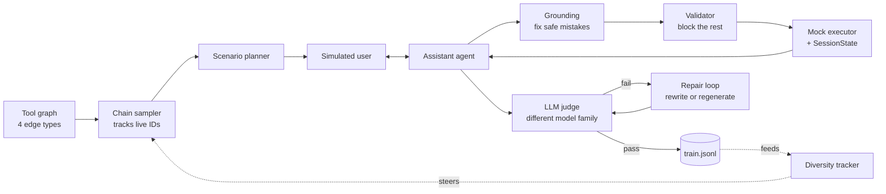

# Conversation Factory

**Synthetic multi-turn tool-calling conversations for LLM training,
with structural validity guaranteed before a single LLM call.**

---

## Why this exists

Tool-calling models learn from example conversations. When those examples call tools in
the wrong order, pass the wrong argument types, reference IDs that were never returned,
or claim actions that never happened, the model learns those mistakes.

Letting an LLM generate conversations freely produces exactly these errors.
**Conversation Factory makes them structurally impossible, then catches what remains.**

## At a glance

| | |
|---|---|
| **18 / 18** | injected errors caught by the LLM judge, with **0 false alarms** |
| **0.24 → 0.98** | category balance after diversity steering |
| **3 levels** | of quality control: rules, LLM judge, repair loop |
| **4 edge types** | in the directed tool graph that plans every conversation |
| **3 models** | routed by role: assistant, user simulator, and judge |

## Architecture

### 1 · Plan: a graph decides what's possible

26 tools across travel, ecommerce, calendar and banking form a **directed graph**. An edge
A → B means B makes sense after A, weighted by four signals: **data flow** (A's output is
B's required input), **shared parameters**, **operation order** (search → read → create →
update → delete), and **shared category**.

A stateful **sampler** walks the graph and tracks which IDs are alive. Every conversation
starts with a tool a real user could call, every ID is produced before it's used, and
nothing is touched after it's deleted. **Structure is guaranteed before any LLM runs.**

### 2 · Generate: agents act it out

Orchestrated with **LangGraph**:

- **Scenario planner** invents a realistic persona with a goal the tools can actually satisfy.
- **Simulated user** speaks like that person, with a guard that catches it slipping into
  the assistant's voice.
- **Assistant** reasons and calls tools against a **mock world** that stays consistent:
  a $226 booking refunds $226, price filters are respected, deleted records stay deleted.

The world (**SessionState**, keyed by ID for O(1) lookups) is kept separate from the
dialogue (**ConversationState**), which keeps grounding reliable.

### 3 · Verify: three independent quality levels

| Level | How | Cost |
|---|---|---|
| **1 · Rules** | Grounding fixes safe mistakes (placeholder IDs, names used as IDs, wrong types) and logs every fix. A validator blocks the rest: unknown or deleted IDs, malformed dates and emails, duplicate actions. | Free |
| **2 · LLM judge** | A model from a **different family** scores correctness, naturalness, groundedness and completeness. Passing needs a mean of 3.5 **and** no score below 3, so one serious flaw can't be averaged away. | 1 call |
| **3 · Repair** | Wording-only issues are rewritten without touching tool calls. Anything deeper is regenerated, with a fresh scenario on the second attempt. | 1 to 10 calls |

Cheapest checks run first, so expensive ones only see what rules can't catch.

### 4 · Steer: diversity by measurement

A tracker measures category balance, tool coverage, chain length and repeated personas
across the accepted corpus, then steers the next batch toward what's missing:
under-used categories first, rare tools boosted, longer chains when needed, new names.

## Results

### The judge, evaluated

An unvalidated judge is a liability. To test it, I took conversations reviewed as good,
**injected one known flaw at a time**, and checked whether the judge failed them.
Unmodified originals served as controls.

| Injected flaw | Judge v1 | Judge v2 |
|---|:---:|:---:|
| Wrong number in the reply | ✅ 3/3 | ✅ 3/3 |
| Claims an action that never ran | ✅ 3/3 | ✅ 3/3 |
| Invented detail | ✅ 3/3 | ✅ 3/3 |
| ID never returned by any tool | ✅ 3/3 | ✅ 3/3 |
| Tool call removed, reply kept | ✅ 3/3 | ✅ 3/3 |
| Vague final reply (*"Okay, noted."*) | ⚠️ 1/3 | ✅ 3/3 |
| **False alarms on good conversations** | **0/3** | **0/3** |

v1 had a blind spot: it judged completeness by whether the tools ran, not whether the user
was told. One rubric change closed it without adding false alarms.

### Steering, measured

Over 400 sampled chains, random sampling put **49%** of conversations in one category,
because that category holds 3 of the 7 tools a conversation can start with. Steering
brought **category balance from 0.24 to 0.98**.

### Debugging the pipeline from its rejects

A 10-conversation baseline passed 6, with **groundedness of 4.89 / 5** on accepted data.
Reading every reject showed the repair loop wasn't the problem: **3 of 4 failures started
upstream**. The planner was inventing needs no tool could satisfy (gate numbers, delivery
guarantees, date filters), and the smaller simulator model sometimes answered as the
assistant. Regeneration kept reusing the same impossible scenario.

The fixes went to the source: the planner now sees each tool's return fields, a
rule-based check catches role drift, and the second regeneration plans a fresh scenario.

## What building it taught me

> **Structural validity is cheaper to guarantee than to detect.**
> The graph makes whole classes of errors impossible, so the judge only handles meaning.

> **Read the output.**
> The most important bugs came from reading samples, not tests: a mock ignoring price
> filters, a chain reading an event after deleting it, an assistant claiming it CC'd
> someone when the email tool had no CC option.

> **Test the tester.**
> An LLM judge needs its own evaluation. Controlled corruption produces labeled test
> cases for free.

> **Fix failures where they start.**
> No repair loop can rescue a conversation whose scenario was impossible to begin with.

---

Built with Python · LangGraph · NetworkX · Pydantic · asyncio
Provider-agnostic: runs on any OpenAI-compatible API

